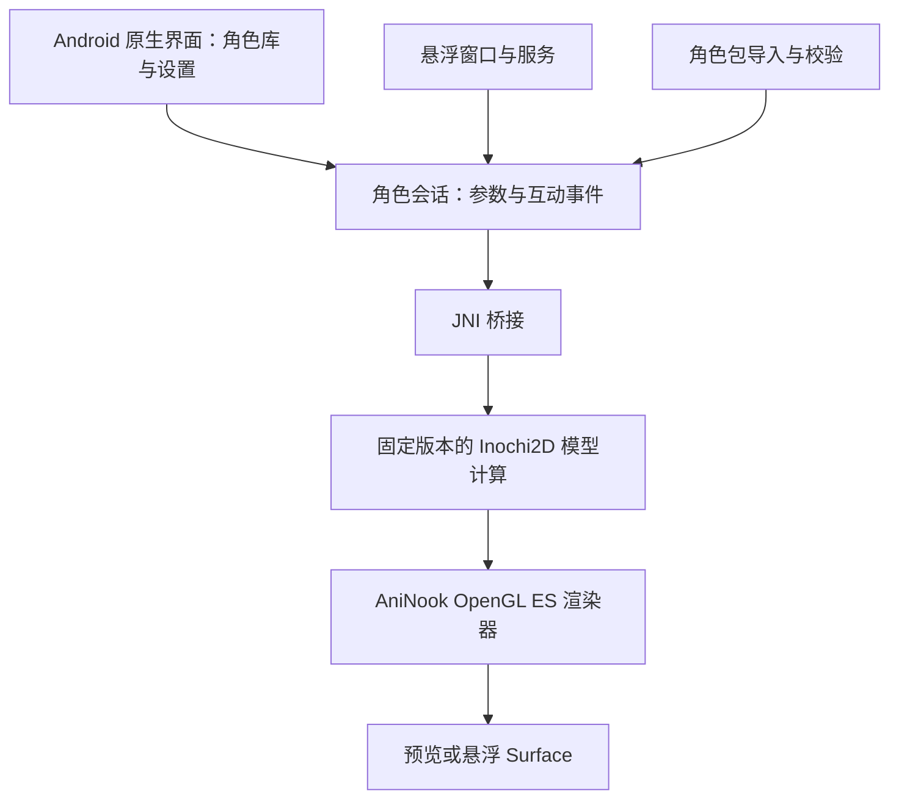

# AniNook：Inochi2D 原生 Android 适配与长期维护评估

日期：2026-10-18。目标：单人开发、Android 原生桌宠、二维动态立绘、免费开源角色动画方案、玩家导入和分享角色。

## 结论与建议

**Inochi2D 具备移植的技术基础，视觉表现和开放创作链符合 AniNook；但目前不能作为省心、现成的 Android SDK。建议保留为首选验证候选，暂不承诺为产品永久依赖。**

如果采用，需要承担 Android 发行库、JNI 桥接、手机渲染器、模型兼容与回归测试的维护。这是一项小型引擎移植工作，不能按“接一个库”估算。用户已优先选择 Android 原生开发，不再以 Godot 插件作为当前技术主线。

本次完成官方源码静态检查、发行与分支元数据核对、维护者答复和 Android 文档调研。**没有编译 Android 库、制作 APK、运行模型或进行真机性能/功耗测试。** 因而下文“可行”指架构可行性，“工期”和“验收指标”均为建议，非实测结果。

## 证据与版本基线

为避免网页缓存和 `main` 漂移混淆，源码审查固定 SDK 提交 `4975d247f9b946a74d18e0ba9b3e9475eb636efb`，提交日期 2026-10-03。经 GitHub API 取得选定文件内容，在本地检查了构建配置、C 头文件/实现、模型加载、渲染状态和示例。未运行上游脚本。

| 对象 | 此次确认的状态 | 对选型的影响 |
| --- | --- | --- |
| SDK 稳定发行 | 最新非预发布为 v0.8.7，2024-10-02；该 Release 没有附加二进制资产（GitHub 自动源码包另计） | 不能将 main 的新接口当作 0.8.7 的功能 |
| SDK 开发分支 | 固定提交如上；代码包含 0.9/INP2 迁移和自带渲染器接口 | 有近期开发，不能说项目已停止维护；但移动集成要固定版本 |
| SDK nightly | 有 Linux、macOS、Windows、WASM 资产；没有 Android 命名资产；各平台资产更新时间不完全相同 | 不可把 nightly 标签视为所有平台完全相同的构建；Linux 库不等于 Android 库 |
| Inochi Creator | 最新发行 v0.8.6，2024-09-18；发行资产为桌面平台及修复工具 | 创作者可在电脑制作；不能承诺手机上有官方编辑器 |
| Creator 默认分支 | `v0_8`，所查 HEAD `dba60811cff224f8cc9ce367b1d9291bfa5f7640`，2025-03-12 | 此日期只代表所查默认分支，不代表所有分支最近活动 |
| 旧 `inochi2d-c` | HEAD `f463e366f9395693d2c95789d92dfd70f07c4e9a`，2023-07-16 | 它的 `inInit`/`inLoadPuppet` 教程不应混用于新 SDK 的 `in_puppet_*` API |
| Rust Inox2D | HEAD `d4dd9dd7f16b775042cbda44370570abf9a8cf81`，2026-09-23；README 仍标实验/原型、不建议生产使用 | 有近期修复不等于功能完整或已验证 Android |

来源：[SDK Releases](https://github.com/Inochi2D/inochi2d/releases)、[固定 SDK 提交](https://github.com/Inochi2D/inochi2d/commit/4975d247f9b946a74d18e0ba9b3e9475eb636efb)、[Creator Releases](https://github.com/Inochi2D/inochi-creator/releases)、[Creator 默认分支提交](https://github.com/Inochi2D/inochi-creator/commit/dba60811cff224f8cc9ce367b1d9291bfa5f7640)、[旧 C 绑定](https://github.com/Inochi2D/inochi2d-c)、[Inox2D](https://github.com/Inochi2D/inox2d)。

### Android 官方支持证据

官方 Issue #73 仍开放。维护者在 2025-12-16 答复中表示没有 Android 设备、已多年未开发 Android，建议自行编译库、实现 Java 绑定和图形接口对接。这是维护者当时的支持能力说明，不是平台永远不支持的声明，也不是移植成功证明。

固定提交中的发行工作流矩阵为 macOS、Windows、Linux、WASM；测试工作流也没有 Android 项。本次公开检索没有找到可核实的、持续维护的官方 Android AAR/JNI 示例或已测试的完整 Android 移植项目。结论限定于本次所查资料，不声称全网不存在个人实验。

来源：[Android Issue #73](https://github.com/Inochi2D/inochi2d/issues/73)、[构建工作流](https://github.com/Inochi2D/inochi2d/blob/4975d247f9b946a74d18e0ba9b3e9475eb636efb/.github/workflows/build.yml)、[测试工作流](https://github.com/Inochi2D/inochi2d/blob/4975d247f9b946a74d18e0ba9b3e9475eb636efb/.github/workflows/build-test.yml)。

## 哪些已有，哪些需要我们完成

| 部分 | 已有基础 | AniNook 要补的部分 | 难度判断 |
| --- | --- | --- | --- |
| 创作与模型计算 | 分层立绘、网格形变、参数、物理；桌面 Creator | 适合手机的角色制作规范、模板与验证器 | 中 |
| 编译 | D/LDC、DUB、C ABI、Aarch64 代码路径 | Android NDK/Bionic 目标、依赖锁定、可复现的 `.so` 与 AAR 打包 | 中高，可能成为阻塞项 |
| Kotlin 接入 | 新版 C 接口 | JNI 生命周期、句柄、错误处理、线程与内存所有权 | 中 |
| 手机绘制 | Draw List 提供顶点、纹理、状态等 | OpenGL ES 绘制、遮罩、合成、混合、透明边缘与颜色一致性 | 高，主要工作量 |
| 手机悬浮 | Android 系统窗口和服务机制 | 透明 Surface、触摸区域、锁屏/恢复、后台限制、节能 | 中高；属于桌宠应用的工作，换 SDK 也不能消除 |
| 玩家导入 | 文件及内存加载接口 | 安全解析限制、支持版本检查、创作者错误提示、共享来源与许可记录 | 中高 |
| 长期维护 | 开源代码可修复、可固定版本 | Android CI、GPU/系统矩阵、回归模型集、上游升级评审 | 持续成本较高 |

难度为本次工程判断，不是上游给出的评级。

## 编译：能生成 ARM 代码，不代表已能在 APK 中加载

固定提交的 `dub.sdl` 要求 **LDC >= 1.40.0**，DMD/GDC 不在该配置支持范围。依赖包括 `numath`、`intel-intrinsics`、`gamut`、`nulib`、`numem`、`nurt` 及内部 INP 模块；其中多项使用 `>=` 或 `*`，正式集成需锁定解析后的依赖版本。

较好的消息是，新 `dynamic` 配置启用 `nurt-enabled`，不是简单地沿用完整 D GC 运行时。C FFI 也标注了 `@nogc`。因此把“必须移植完整 D 垃圾回收器”列为已确定前提是不准确的。但 NuRT、内存分配、TLS、初始化和依赖对 Android 的兼容仍须实测，`@nogc` 不代表不存在内存分配或所有运行时依赖。

LDC 本身提供 Android 发行与相关构建能力，说明 D 语言不是不可跨越的障碍。LDC 1.38 的 Android 运行时调整涉及 native ELF TLS/API 29；这个限制不能未经验证直接套在使用 NuRT 的新版 Inochi2D 上。应根据最终链接依赖确定 AniNook 的最低 Android 版本。

建议先做 **arm64-v8a**，使用 Android NDK sysroot/Bionic 与正确 Android target 编译、链接；不能直接装入普通 Linux Aarch64/glibc `.so`。在 APK 内做真实加载测试，检查未解析符号、依赖库、异常/错误处理和 16 KB 页兼容。后者是设备兼容工作，不应把 Google Play 的上架要求误说成 TapTap 的规定。

来源：[固定构建配置](https://github.com/Inochi2D/inochi2d/blob/4975d247f9b946a74d18e0ba9b3e9475eb636efb/dub.sdl)、[NuRT](https://github.com/Inochi2D/nurt)、[LDC 平台与安装说明](https://github.com/ldc-developers/ldc)、[LDC 更新记录](https://github.com/ldc-developers/ldc/blob/master/CHANGELOG.md)、[Android NDK 外部构建系统](https://developer.android.com/ndk/guides/other_build_systems)、[16 KB 页兼容](https://developer.android.com/guide/practices/page-sizes)。

## 渲染：不能直接复制桌面示例

0.8.7 README 要求桌面 OpenGL 3.1；Android 常用的 OpenGL ES 不是同一套兼容目标。新开发分支采用自行提供渲染器的 Draw List 架构，更适合原生适配，但绘制结果仍由接入方负责。

本次代码审查发现：

- `examples/basic-gl/src/main.c:461` 仍有未完成渲染循环的 TODO；后续代码跳过 Composite，遮罩状态没有完整绘制实现。这只是极简示例，不能当完整模型兼容渲染器。
- 示例 shader 使用桌面 GLSL `#version 330` / `420`，代码还使用 `glDrawElementsBaseVertex`、`GL_CLAMP_TO_BORDER`、矩阵转置上传等路径，不能原样照搬为 OpenGL ES 3.0。可检查并使用 SDK 提供的关闭 base-vertex 路径，再验证实际顶点索引结果。
- `tech-docs/building-a-renderer.md` 中状态表使用 `maskedDraw=2`、`compositeBegin=3`；同一提交的 C 头文件和实现则为 `PUSH_MASK=2`、`POP_MASK=3`、`COMPOSITE_BEGIN=4`。应以匹配提交的实现为准，并建立测试，不能仅靠说明文档编码。
- 新 INP2 文档列出 BC7 纹理格式，但当前 `puppet.d` 中 BC7 加载仍为未实现断言。首版应明确允许的格式，不能因为规范列出格式就宣称运行库已支持。

建议采用 **OpenGL ES 3.0 作为验证起点**，先完成正常透明混合、常用混合模式、遮罩与合成；高级模式用能力检查和明确拒绝处理，不悄悄替换成 Normal 后仍声称兼容。是否需要 ES 扩展取决于最终实现与设备验证。暂不为一只二维桌宠另起 Vulkan 后端。

采用 C/C++ JNI 桥与渲染模块，让每帧计算和 Draw List 消费留在 native 侧，Kotlin 传递参数/事件，避免逐顶点跨 JNI 搬运。预览与悬浮共用实现，但不默认共享跨 EGL context 的纹理 ID；应明确定义 Surface 创建、销毁和重建时的资源归属。

来源：[0.8.7 平台要求](https://github.com/Inochi2D/inochi2d/blob/v0.8.7/README.md)、[渲染说明](https://github.com/Inochi2D/inochi2d/blob/4975d247f9b946a74d18e0ba9b3e9475eb636efb/tech-docs/building-a-renderer.md)、[示例渲染循环](https://github.com/Inochi2D/inochi2d/blob/4975d247f9b946a74d18e0ba9b3e9475eb636efb/examples/basic-gl/src/main.c#L461)、[C 头文件](https://github.com/Inochi2D/inochi2d/blob/4975d247f9b946a74d18e0ba9b3e9475eb636efb/include/inochi2d.h#L256)、[模型加载实现](https://github.com/Inochi2D/inochi2d/blob/4975d247f9b946a74d18e0ba9b3e9475eb636efb/source/inochi2d/puppet.d#L195)、[Android JNI 建议](https://developer.android.com/ndk/guides/jni-tips)、[GL Surface 重建](https://developer.android.com/reference/android/opengl/GLSurfaceView.Renderer)。

## 版本、创作者与用户导入

不要将三个东西混为一谈：桌面 Creator 的版本、SDK 的提交、文件内容采用的格式。Creator 0.8.6 依赖 0.8 系列 SDK；新主线已有 INP2，并在代码中尝试升级旧 INP1 内容。这说明存在兼容意图，不是所有旧模型无损兼容的实测保证。

建议第一轮固定 Creator 发行版和 SDK 提交，选取获准测试的模型验证完整流程，再定义 **AniNook 角色兼容配置 v1**，写清允许的节点、纹理、混合模式、参数与资源上限。保留原模型文件，不强制用户破坏性转换。

外层角色包使用独立版本号，包含作者、许可、模型格式/版本、所需特性、互动映射、封面。每次引擎升级跑旧包回归；本地模型不应依赖服务器在线。兼容失败给出具体原因，避免模型看似导入成功却缺眼睛、头发或表情。

原生 C API 已有 `in_puppet_load_from_memory`，可以由 Android 系统文件选择器取得数据后传入；不必假设 `content://` 是可直接交给 C 库的文件路径。

用户导入的数据必须限制文件大小、解析深度、节点/顶点数量、解码像素量和纹理预算。当前模型加载实现包含断言和本机内存操作，Kotlin `try/catch` 无法承诺拦截全部 native 崩溃；在面向公开上传前，需要错误样本、随机/截断输入测试与失败恢复。此项是安全与稳定性工作需求，不是已确认存在可利用漏洞。

量级示例（计算而非实测）：一张 4096×4096 RGBA8 纹理，仅像素数据就是 64 MiB；CPU 解码副本、GPU 副本、mipmap、合成缓冲还会增加内存。桌面模型体积小也不能保证手机内存占用低。

来源：[Creator 0.8.6 构建依赖](https://github.com/Inochi2D/inochi-creator/blob/v0.8.6/dub.sdl)、[INP2 文档](https://github.com/Inochi2D/inochi2d/blob/4975d247f9b946a74d18e0ba9b3e9475eb636efb/tech-docs/inp2.md)、[旧模型加载路径](https://github.com/Inochi2D/inochi2d/blob/4975d247f9b946a74d18e0ba9b3e9475eb636efb/source/inochi2d/puppet.d#L429)、[内存导入接口实现](https://github.com/Inochi2D/inochi2d/blob/4975d247f9b946a74d18e0ba9b3e9475eb636efb/source/inochi2d/cffi.d#L277)。

## 原生应用边界与持续维护

建议结构：

渲染、模型加载与资源释放先串行在明确的 native 工作线程执行；UI/触摸事件进入队列。不假定 SDK 任意对象都线程安全。Surface 丢失和应用被系统结束要能恢复保存的角色选择；隐藏/锁屏时停止无意义的渲染，恢复时限制物理步长，避免大时间差造成跳动。

系统悬浮权限、前台服务类型与启动条件、通知、OEM 后台限制需要独立处理。前台服务不保证永不被杀；透明像素也不自动意味着触摸穿透。优先用较小的角色窗口控制遮挡，具体交互区域与 Android 的触摸安全规则一起实测。

来源：[Android 窗口与触摸规则](https://developer.android.com/reference/android/view/WindowManager.LayoutParams#FLAG_NOT_TOUCHABLE)、[前台服务类型](https://developer.android.com/develop/background-work/services/fgs/service-types)、[前台服务说明](https://developer.android.com/develop/background-work/services/fgs)。

长期应固定 SDK 提交和依赖锁文件，建立 Android 构建流水线，保存可重现工具链与 native 调试符号；维护至少覆盖两类 GPU 的真机结果。只定期评审上游更新，不自动追踪 main。尽量把补丁限制在编译、平台适配和可提交上游的小修复；若持续需要修改模型语义或大面积重写运行时，应重新评估投入。

## 其他接入路径为什么暂不优先

- **移植 0.8.7 的桌面渲染器：**旧版创作者链更匹配，但需要处理桌面 GL 到 GLES，并可能在以后承担 0.9 迁移。可作对照实现，不因名称含“稳定版”就认为它最适合 Android。
- **新版 D 核心 + 我们的 GLES：**职责边界最符合原生路线，也是本次首选验证方向；代价是新接口和兼容性尚需验证。
- **Rust Inox2D：**README 明确不推荐生产使用，功能清单仍列出未完成动画、MeshGroup、Z-sort 等；未逐项运行证实当前实现状态，不能仅凭 Rust 的移动工具链更熟悉就认定更省事。
- **WASM/WebView：**有 WASM 产物不等于具备完整移动渲染与悬浮方案；这条路还增加 WebView 生命周期、桥接和功耗变量，不作为避开移植工作的捷径。
- **重写 Kotlin 动画引擎或另做手机角色编辑器：**会把工作扩大为实现模型标准与创作工具，不适合当前单人省维护目标。

## 开源许可与资产边界

SDK 和 Creator 主许可均为 BSD-2-Clause，适合免费分发、修改与集成，按许可保留声明。不存在由这两个主许可证本身规定的按用户量或广告收入收取运行费的条款。但本轮未完整审计锁定依赖的所有许可证；正式发布需核对第三方依赖清单与声明。

模型、美术、音频是独立作品，不能因运行库开源就认为可随意分享。Inochi 格式也不等于 Live2D `.moc3`；不能承诺直接导入现有 Live2D 模型。以授权分层原画在 Creator 重新绑定，是不同于格式兼容的制作流程。

来源：[SDK LICENSE](https://github.com/Inochi2D/inochi2d/blob/4975d247f9b946a74d18e0ba9b3e9475eb636efb/LICENSE)、[Creator LICENSE](https://github.com/Inochi2D/inochi-creator/blob/v0.8.6/LICENSE)、[官方旧版文档中的格式说明](https://docs.inochi2d.com/_/downloads/en/latest/pdf/)。

## 验证阶段、投入估计与退出条件

此前 Godot 调研中的“1–2 个开发日”只适合识别明显阻塞，不适合承诺完整 Android 移植。本次基于源码证据重新建议：**先给 5–10 个实际开发日的验证预算，阶段结束后决定是否承诺长期使用。** 这是待执行建议，当前未开始这些测试。

| 阶段 | 必须交付的证据 | 不通过时的处理 |
| --- | --- | --- |
| 1. 编译与加载 | 固定工具链，从干净环境可构建 arm64 APK；能通过 JNI 加载/释放一个模型；核对 ABI、依赖符号与页对齐 | 若需广泛修改编译器、NuRT 或大量依赖，暂停把该 SDK 定为生产依赖 |
| 2. 实际模型绘制 | 至少 3 个获准测试的模型，覆盖参数形变、遮罩、合成和物理；与桌面基准画面对照 | 只有简单图片能显示，不算通过；旧模型兼容差则重新定范围 |
| 3. 悬浮与恢复 | 两款不同 GPU 的 Android 真机，切换应用、锁屏/恢复、移除/重建 Surface、切换角色与撤销权限 | 持续黑屏、资源泄漏、明显发热或严重遮挡需先修复 |
| 4. 生产采用评审 | Creator 导出到手机导入的可复现步骤、能力清单、性能记录和补丁清单 | 创作者仍需开发者逐模型修补，或补丁面过大，则不扩展公共分享 |

5–10 日结束时未完成后面阶段，应按已取得证据决定是否追加预算，不能把预算到期解释为验证成功。

建议初始性能目标（均未测量）：单角色 30 fps，记录 P95 帧时、PSS/峰值内存和 GPU 表现；连续运行 60 分钟并做至少 50 次角色切换/Surface 重建，观察是否有持续增长；锁屏后停止渲染任务。功耗用同机、同亮度、同网络条件的启用/关闭对照测量，不先承诺每小时耗电百分比。视觉通过标准由测试模型特性逐项确定。

若由熟悉 Android NDK、图形渲染和跨语言构建的开发者执行，达到“有限模型配置、可小范围测试”的版本，可暂按 **25–50 个全职开发日** 做风险预算，包含前述验证，排除角色美术、公共社区、商店审核和大范围机型支持。对目前主要有 Unity 经验的单人开发者，应另计学习和故障排查，日历时间可能更长。这个估算应在首次编译和真机绘制后重算，没有可靠依据给出成功率或长期维护小时数。

最终判断：**适合愿意建设并维护一层 Android 适配的长期项目；不适合把“免费开源”同时理解为“接入后无需维护”。** AniNook 可以先保留它为首选，但在通过上述关卡前，不宣传任意 INP/INX 导入，也不先投入公共模型社区。
