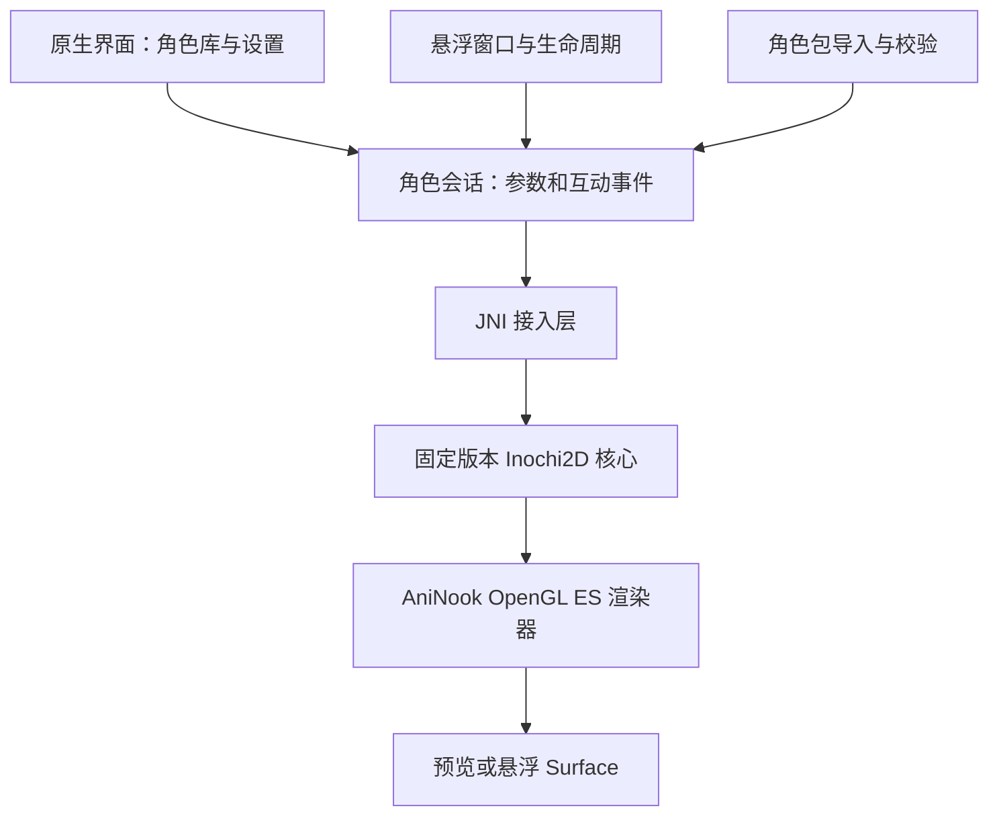

# AniNook：当前技术路线与决策状态

更新：2026-10-19。此文区分已确定方向、工程建议和待实测条件，不把源码调研当作运行验证。

## 决策表

| 项目 | 当前状态 | 方案与边界 |
| --- | --- | --- |
| Android 原生 | 用户已明确优先 | 不再以 Godot 作为默认主线 |
| 免费开源动画技术 | 用户已明确 | Inochi2D 为首选验证候选，未锁定生产使用 |
| Kotlin / Jetpack Compose | 已用于 0.1 验证工程 | 应用界面、权限与文件入口；固定版本见 README |
| D 核心 + C/C++ JNI | 条件性建议 | 保留 Inochi2D 核心，只建立 Android 接入层，不整体重写引擎 |
| OpenGL ES 3.0 | 验证起点 | 自行实现所需绘制；扩展要求依据功能与设备确定 |
| arm64-v8a | 首轮验证建议 | 最低 Android 版本与其他 ABI 待构建和设备测试决定 |
| 原生悬浮窗口与服务 | 工程建议 | 权限、触摸、后台限制、锁屏与恢复均须验证 |
| 数据型角色包 | 工程建议 | 外层包与模型分别版本化；不执行用户代码 |
| HTTPS 静态资源目录 | 后续建议 | 首先本地导入，之后只读资源源，再评估上传服务 |
| 应用源码许可、广告、发布渠道细节 | 未定 | 不影响本地样本验证；公开发布前需明确相关事项 |

## 当前实现进度

已建立 Android 外壳验证工程，minSdk 26、compile/targetSdk 36。Canvas 占位角色仅用于验证窗口；JNI、D 核心和 GLES 模型渲染尚未实现。NDK/LDC/DUB 仍未选定，不能将 UI 构建通过视作 Inochi2D 关卡通过。见 [实现边界](development/preview-architecture.md) 与 [验证记录](validation/2026-10-19-preview.md)。

## 组件边界

模型计算与绘制尽量在 native 侧完成，避免每帧逐顶点跨 JNI 传输。UI 事件通过明确队列交给角色会话；不假定 SDK 任意对象都线程安全。预览与悬浮复用渲染实现，但图形资源必须按实际 EGL context 管理和重建。

Android 悬浮权限、通知、前台服务与系统生命周期独立于动画库。透明像素不等同于触摸穿透，服务也不能保证永远不被系统终止；具体行为以系统规则和实测为准。

## Inochi2D 验证基线

前期源码审查固定 SDK 提交 `4975d247f9b946a74d18e0ba9b3e9475eb636efb`。这是研究基线，不是已验证的生产版本。开发分支涉及 0.9/INP2 迁移；Creator 0.8.6 与新核心的实际兼容必须确认。

构建需要锁定 SDK 提交、D/LDC/DUB、Android SDK/NDK/JDK/Gradle 及传递依赖。当前不凭猜测指定整套版本组合。使用 Android target 与 sysroot，不能将普通 Linux ARM 库直接当作 Android 库。

自建渲染器需验证透明混合、遮罩、合成、支持的混合模式与形变。官方基础示例存在未实现部分，不能视作完整兼容实现。不同版本文档和接口可能不一致，按同一提交核对。

完整证据与官方来源见 [Inochi2D Android 深度调研](research/inochi2d-android-2026-10-18.md)。

## 角色格式与扩展边界

角色外层包建议包含版本化清单、模型与纹理、预览、作者和许可、互动事件映射。正式字段和资源阈值应在模型测试之后冻结。

建立明确的兼容配置，说明支持的模型版本、节点、混合方式、纹理与资源上限。保留原模型，失败给出可理解的原因；不声称所有同后缀文件都能工作。模型包限制文件路径、解压规模与解码资源，公共分享前补充异常输入验证。

资源源后续可采用 HTTPS 索引和静态托管，用户显式添加来源。校验值用于完整性，不证明来源可信或版权合法。已下载角色应能离线使用。公共上传、账号、审核与存储服务另行设计。

## 长期维护策略

固定版本和依赖，建立可重复构建、真机测试记录及代表模型回归集；评审上游变更后再升级，不自动追踪 main。保存 native 调试符号与补丁说明。

首轮尽量只修改平台适配及小范围缺陷。如果稳定运行要求广泛修改编译器、运行时或模型语义，重新评估选型。现阶段没有已验证的替代方案可无成本切换，验证失败时应提交证据和新的范围/方案建议。

入口：[项目目标](project-goals.md)、[验证计划](readiness-and-validation.md)。
